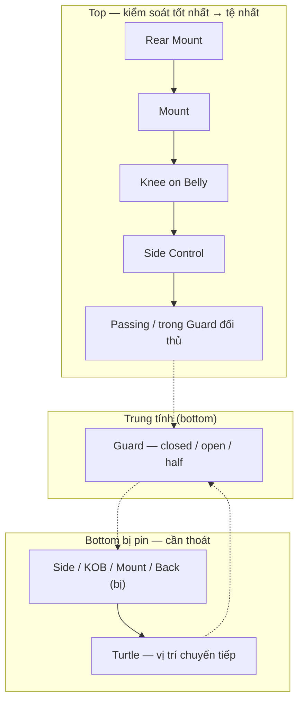
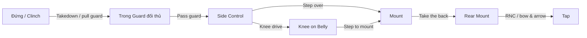
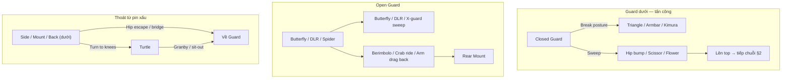
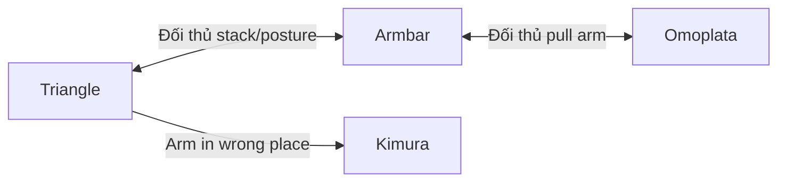
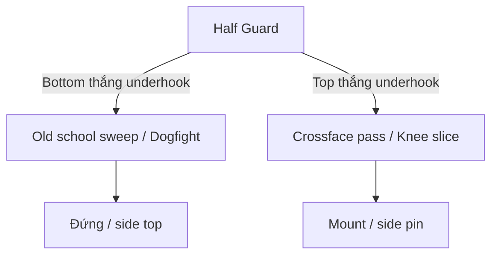
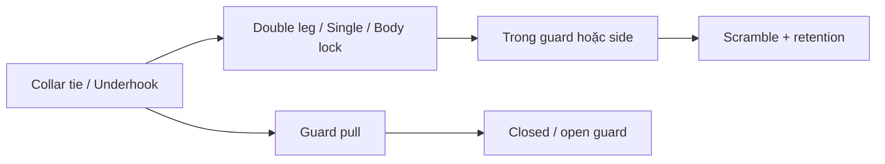

# Sơ đồ chuyển vị trí & chuỗi tấn công BJJ

> Bản đồ trạng thái và các skill có thể móc nối thành chuỗi. Chi tiết từng kỹ năng: [TAT-CA-KY-NANG-BJJ.md](./TAT-CA-KY-NANG-BJJ.md) → `ky-nang/`.

---

## 1. Phân cấp vị trí (ai đang thắng?)

**Quy tắc vàng:** Nếu bạn ở dưới ngoài Guard → đang thua. Thoát hoặc về Guard trước khi nghĩ tới submission.

---

## 2. Chuyển trạng thái — Top tiến công

### Skill móc nối (Top cổ điển)

| Bước | Vị trí | Kỹ năng | Chi tiết |
|------|--------|---------|----------|
| 1 | Trong Guard | [Knee cut](./ky-nang/knee-cut-pass.md), [Over-under](./ky-nang/over-under-pass.md), [Toreando](./ky-nang/toreando-pass.md) | Pass trước, khóa sau |
| 2 | Side Control | [Crossface pin](./ky-nang/crossface-pin.md), [Americana](./ky-nang/americana.md), [Knee drive → mount](./ky-nang/knee-drive-mount.md) | Giữ pin hoặc lên mount |
| 3 | Mount | [Armbar](./ky-nang/armbar.md), [Ezekiel](./ky-nang/ezekiel-choke.md), [Lấy lưng](./ky-nang/roll-through-armbar-back.md) | Position before submission |
| 4 | Rear Mount | [RNC](./ky-nang/rear-naked-choke.md), [Bow & arrow](./ky-nang/bow-and-arrow-choke.md) | Finish |

---

## 3. Chuyển trạng thái — Bottom phòng thủ / tấn công

### Combo Closed Guard (A fail → B)

| Chuỗi | Skill | Link |
|-------|-------|------|
| Posture → submit | Closed guard bottom, Triangle, Armbar | [closed-guard-bottom](./ky-nang/closed-guard-bottom.md), [triangle](./ky-nang/triangle-choke.md) |
| Sweep → top | Hip bump, Scissor, Flower | [hip-bump-sweep](./ky-nang/hip-bump-sweep.md), [scissor-sweep](./ky-nang/scissor-sweep.md) |
| Open → back | Berimbolo, Crab ride | [berimbolo](./ky-nang/berimbolo.md), [crab-ride](./ky-nang/crab-ride.md) |

---

## 4. Half Guard — tranh underhook

| Vai trò | Skill |
|---------|-------|
| Bottom | [Standard half](./ky-nang/standard-half-guard.md), [Old school sweep](./ky-nang/old-school-half-sweep.md), [Underhook](./ky-nang/underhook.md) |
| Top | [Crossface underhook pass](./ky-nang/crossface-underhook-pass.md), [Knee slice → mount](./ky-nang/knee-slide-to-mount-pass.md) |

---

## 5. Đứng → Ground

---

## 6. Nguyên tắc móc nối

1. **Position before submission** — Cải thiện vị trí (pass, sweep, pin) trước khi khóa.
2. **Chain attacks** — Đòn A fail → phản ứng đối thủ mở đòn B (Americana fail → arm triangle; pass fail → đổi pass khác).
3. **Same position, multiple finishes** — Side: Americana / Kimura / arm triangle; Mount: armbar / Ezekiel / back take.
4. **Turtle = bước trung gian** — Không dừng lại; Granby/sit-out về guard hoặc đối thủ lấy back.

---

## 7. Canvas tương tác

Mở **BJJ — Chuyển vị trí & Chuỗi tấn công** trong Cursor Canvas để xem sơ đồ DAG có thể cuộn và chọn 6 chuỗi tấn công mẫu.

---

*Tham chiếu: [HUONG-DAN-BJJ.md](./HUONG-DAN-BJJ.md) §3–§7, [TAT-CA-KY-NANG-BJJ.md](./TAT-CA-KY-NANG-BJJ.md) §10.*
