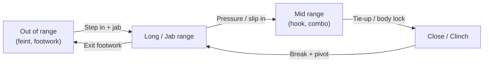
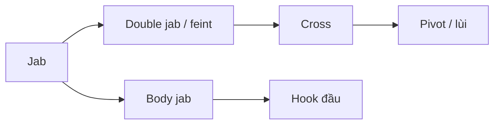
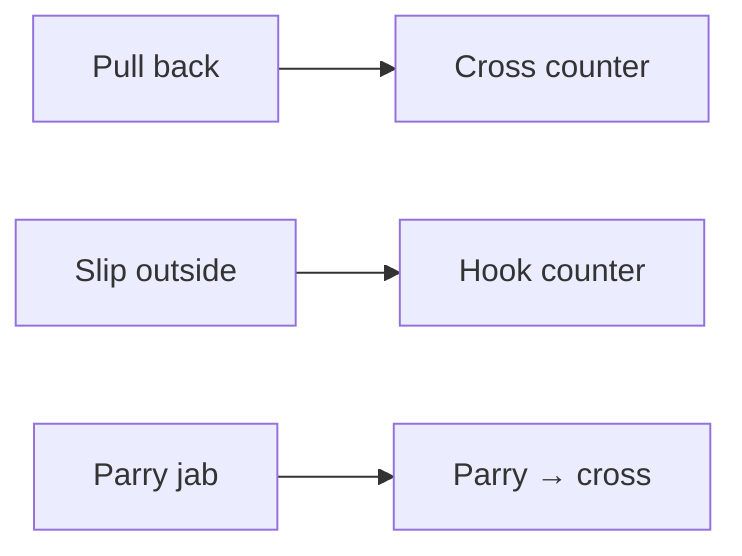
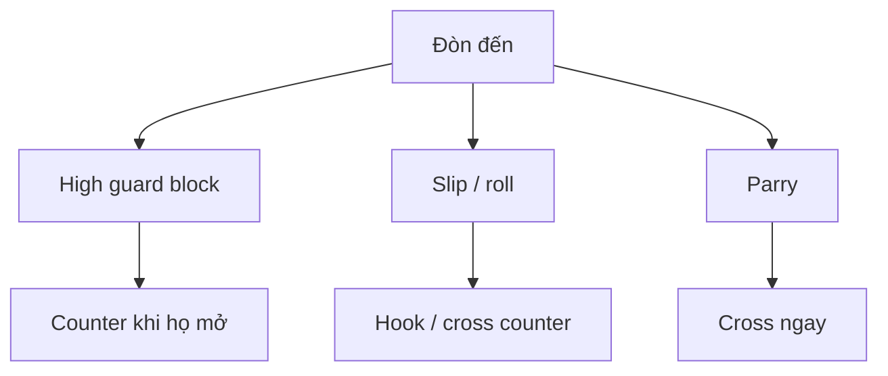

# Sơ đồ chuyển range & chuỗi tấn công Boxing

> Bản đồ khoảng cách và các skill móc nối. Chi tiết: [TAT-CA-KY-NANG-BOXING.md](./TAT-CA-KY-NANG-BOXING.md) → `ky-nang/`.

---

## 1. Bốn khoảng cách (Range)

**Quy tắc:** Out-boxer sống ở LONG; pressure fighter đẩy MID → CLOSE; counter-puncher nhử ở LONG rồi counter ở MID.

---

## 2. Chuỗi Out-boxer (người mới)

| Bước | Skill | Chi tiết |
|------|-------|----------|
| 1 | Jab, double jab | [jab](./ky-nang/jab.md), [double jab](./ky-nang/double-jab.md) |
| 2 | 1-2 | [combo 1-2](./ky-nang/combo-1-2.md) |
| 3 | Jab body → head | [body jab](./ky-nang/body-jab.md), [lead hook](./ky-nang/lead-hook.md) |
| 4 | Exit | [footwork](./ky-nang/footwork-basics.md), [pivot](./ky-nang/pivot-angle.md) |

---

## 3. Chuỗi Pressure / In-fighter

| Bước | Skill | Chi tiết |
|------|-------|----------|
| 1 | Head movement vào | [slip inside](./ky-nang/slip-inside.md) |
| 2 | Body shots | [body hook](./ky-nang/body-hook.md), [liver shot](./ky-nang/liver-shot.md) |
| 3 | Inside combo | [inside combo](./ky-nang/inside-combo.md) |
| 4 | Clinch reset | [basic clinch](./ky-nang/basic-clinch.md) |

---

## 4. Chuỗi Counter-puncher

| Setup | Counter | Chi tiết |
|-------|---------|----------|
| Đối thủ over-commit jab | Pull → cross | [pull counter](./ky-nang/pull-counter.md) |
| Cross dài | Slip outside → hook | [slip counter cross](./ky-nang/slip-counter-cross.md) |
| Jab predictable | Parry → cross | [parry counter cross](./ky-nang/parry-counter-cross.md) |

---

## 5. Phòng thủ → Phản công

---

## 6. Nguyên tắc móc nối

1. **Feint trước combo** — jab feint, body feint → đầu mở.
2. **Change level** — body làm hạ guard → hook/overhand đầu.
3. **Punch and move** — không đứng yên sau combo 3+ đòn.
4. **Defense = counter setup** — slip không chỉ để né.

---

*Tham chiếu: [HUONG-DAN-BOXING.md](./HUONG-DAN-BOXING.md) §2–§7.*
